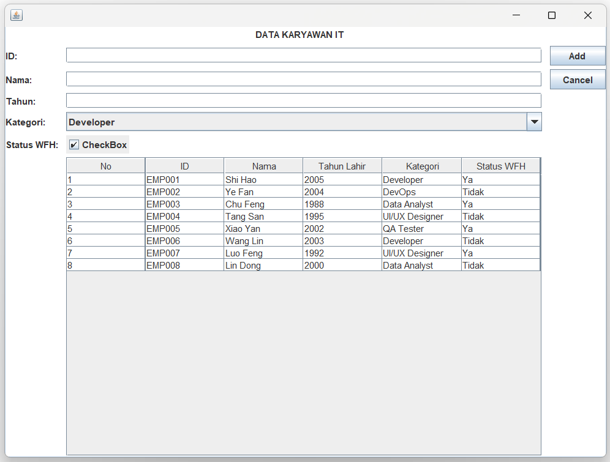

# TUGAS PRAKTIKUM 5 DPBO C1

# JANJI
Saya Rafi Subqhi Nuraziz dengan NIM 2408678 mengerjakan Tugas Praktikum 5 dalam mata kuliah Desain Pemrograman Berorientasi Objek untuk keberkahan-Nya maka saya tidak akan melakukan kecurangan seperti yang telah di spesifikasikan. Aamiin.

---

## 1. Desain Program
Program ini dibangun menggunakan bahasa Java (GUI Swing) dan MySQL. Desain program dirancang dengan memisahkan antarmuka pengguna, model data, dan konektor database ke dalam 3 kelas utama:

*   **Class `Person` (Model Data)**:
    Kelas ini berfungsi sebagai *blueprint* (cetak biru) untuk membentuk objek data karyawan/orang. Kelas ini merepresentasikan struktur tabel dari database di dalam Java, dengan menyimpan atribut: `id`, `nama`, `tahun_lahir`, `kategori`, dan status `wfh`.

*   **Class `Database` (Konektor & Eksekutor SQL)**:
    Kelas ini menangani koneksi sistem ke database MySQL `db_people` melalui JDBC Driver. Kelas ini membungkus *query* SQL agar lebih mudah dipanggil oleh antarmuka. Terdapat dua *method* utama:
    *   `selectQuery(String sql)`: Untuk mengeksekusi *query* `SELECT` (mengambil data untuk ditampilkan ke tabel).
    *   `insertUpdateDeleteQuery(String sql)`: Untuk mengeksekusi operasi manipulasi data (`INSERT`, `UPDATE`, `DELETE`).

*   **Class `PeopleMenu` (GUI & Controller)**:
    Kelas yang mewarisi `JFrame` ini mengatur seluruh antarmuka visual (Tabel, *TextField*, *ComboBox*, Tombol). Kelas ini juga bertindak sebagai pengontrol (*controller*) yang menangkap *event* klik dari pengguna, melakukan validasi input (mencegah form kosong atau duplikasi ID), mengonversi data boolean (untuk status WFH), dan memanggil kelas `Database` untuk melakukan sinkronisasi data secara *real-time* ke MySQL.

## 2. Penjelasan Alur
Program ini merupakan aplikasi Desktop berbasis GUI (Swing) yang melakukan operasi CRUD secara langsung ke database MySQL. Berikut adalah alur kerjanya:

1.  **Inisialisasi & Read (Menampilkan Data):**
    Saat program dijalankan, *constructor* `PeopleMenu` membuat *instance* dari kelas `Database` untuk membuka koneksi ke MySQL. Setelah itu, metode `setTable()` dipanggil untuk mengeksekusi *query* `SELECT * FROM person`. Hasil *query* tersebut di-*looping* dan dimasukkan ke dalam `DefaultTableModel` untuk ditampilkan secara visual pada `JTable`.
2.  **Create (Menambah Data):**
    Pengguna mengisi *textfield* dan *combobox*. Saat tombol "Add" diklik, program akan memvalidasi input untuk memastikan tidak ada kolom yang kosong. Jika lolos validasi, *query* `INSERT INTO` dieksekusi. Jika pengguna memasukkan ID yang sudah terdaftar di database, blok *catch* akan menangkap penolakan dari MySQL dan memunculkan dialog peringatan ID duplikat. Setelah *insert* berhasil, tabel diperbarui dan form dibersihkan.
3.  **Update (Mengubah Data):**
    Pengguna mengklik salah satu baris pada tabel. *MouseListener* akan mendeteksi klik tersebut, mengambil data dari baris yang dipilih, dan mengisinya secara otomatis ke dalam form (kotak ID dikunci agar tidak bisa diedit). Setelah pengguna memodifikasi isian dan menekan "Update", program akan mengeksekusi *query* `UPDATE ... WHERE id = ...`. Data di tabel akan langsung diperbarui.
4.  **Delete (Menghapus Data):**
    Saat baris tabel diklik, tombol "Delete" (yang awalnya disembunyikan) akan muncul. Jika diklik, program memunculkan kotak dialog konfirmasi. Jika disetujui, *query* `DELETE FROM ... WHERE id = ...` dijalankan, data dihapus dari database, dan tabel kembali di-*refresh*.

## 3. Dokumentasi

### A. Read (Menampilkan Data)
Menampilkan seluruh data dari database MySQL ke dalam tabel antarmuka.

### B. Insert (Menambah Data)
- **Insert data berhasil:**
  [Insert Sukses](Dokumentasi/add.mp4)

- **Insert gagal (ID sudah dipakai):**
  [Insert Error ID](Dokumentasi/addgagal1.mp4)

- **Insert gagal (Ada kolom yang kosong):**
  [Insert Error Kosong](Dokumentasi/addgagal2.mp4)

### C. Update (Mengubah Data)
- **Update data berhasil:**
  [Update Sukses](Dokumentasi/update.mp4)

- **Update gagal (Ada kolom yang kosong):**
  [Update Error Kosong](Dokumentasi/updategagal.mp4)

*(Catatan: Error ID duplikat pada Update tidak ada karena kolom ID sengaja dikunci saat baris tabel diklik agar primary key tidak berubah).*

### D. Delete (Menghapus Data)
Menghapus data beserta pop-up konfirmasinya.
[Delete Data](Dokumentasi/delete.mp4)